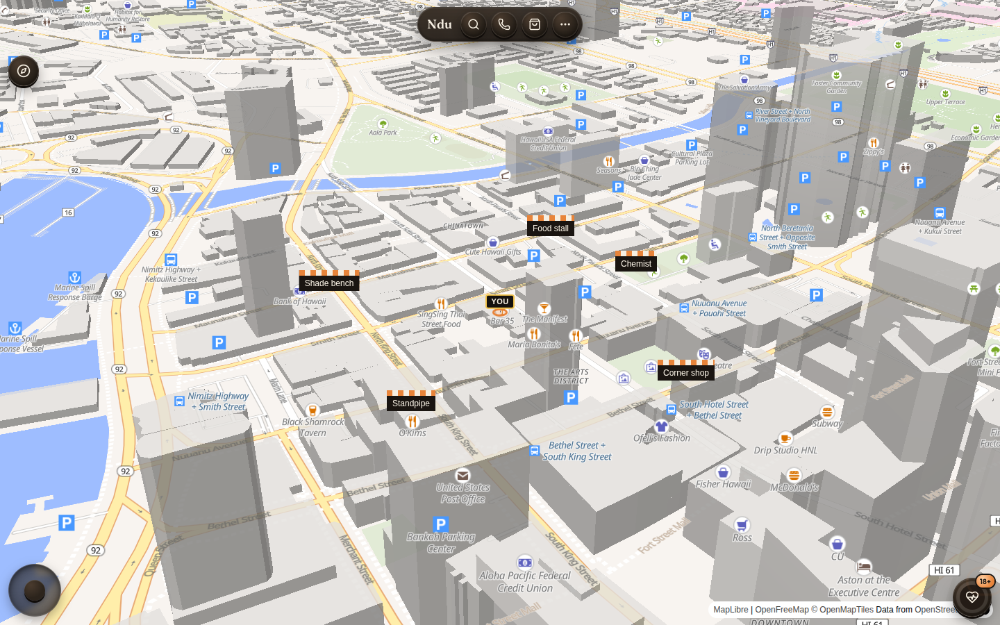

# CityDesk (NDU)

> A walkable, street-level 3D city on the phone: real map data, people at real scale, embossed
> animated UI, scanned rooms and objects, and a property desk with **devnet-only**, user-signed
> verification records. Open source so neighbourhoods can build on it.



**Status:** pre-release. Not production ready. See [docs/ROADMAP.md](docs/ROADMAP.md).

## Vision
A city you can walk at eye height, where every shop, stall and standpipe is a place you can tap,
talk to, and book; where a family can scan its room and keep a private, verifiable record of it;
and where nothing on-chain ever happens without the user signing in their own wallet.

## Quickstart
Requires Node 22+ (and optionally Postgres 16; PGLite is used when `DATABASE_URL` is unset).
```bash
git clone <this repo> citydesk && cd citydesk
npm ci
cp .env.example .env      # fill in your own values; never commit .env
npm run db:migrate
npm run dev               # http://localhost:8080
npm test                  # unit tests
```

## Docs
- [ROADMAP](docs/ROADMAP.md): every feature by phase, with acceptance checks
- [ARCHITECTURE](docs/ARCHITECTURE.md)
- [Good first issues](docs/GOOD_FIRST_ISSUES.md)
- [CONTRIBUTING](CONTRIBUTING.md) · [CODE_OF_CONDUCT](CODE_OF_CONDUCT.md) · [SECURITY](SECURITY.md)

## Ground rules (non-negotiable)
- Solana work is **devnet only**. No mainnet code paths, no minting by default.
- The app **never** holds, generates or asks for a private key or seed phrase. The user signs every transaction.
- Crypto is **receive-only**. No spending, trading or payouts.
- Every app surface stays behind its login.

## License
MIT. See [LICENSE](LICENSE) and `docs/adr/ADR-licence.md`.
